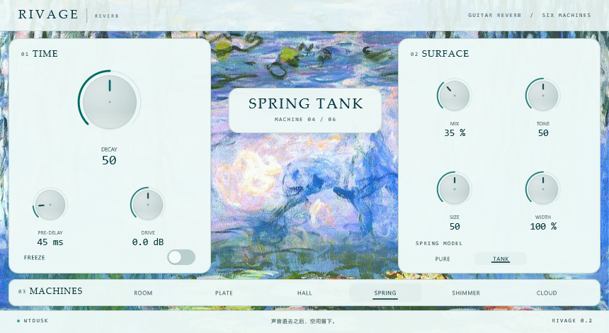

# Rivage Reverb

[](https://github.com/WTdusk/rivage-reverb/actions/workflows/build.yml)
[](LICENSE)

A six-mode algorithmic reverb for electric guitar, built with JUCE. Each mode is
its own signal path rather than a preset on a shared engine — a room with early
reflections and low-frequency modes, a dense plate, a progressive-diffusion hall,
a dispersive spring, a shimmering hall, and a long drifting cloud.

Version 0.2.0 (pre-release). Windows x64 VST3.



## Features

- **Six machines**, each implemented separately:
  - `ROOM` — 14 early-reflection taps, five low-frequency modal resonators, an
    8-line feedback tank with damped low end.
  - `PLATE` — five cascaded allpass diffusers into a short 8-line tank, no early
    reflections, a fixed 3.8 kHz sheen.
  - `HALL` — progressive diffusion: the four diffuser stages fade into the tank
    one after another, so the tail thickens over its first ~70 ms; 16-line FDN.
  - `SPRING` — in two voicings. `PURE` is the 0.1.0 signal path: six coil delays,
    each with 24 first-order allpass stages inside the feedback loop for
    dispersion, no modulation, numerically linear. `TANK` wraps that waveguide in
    the physical chain — a saturating drive transducer, a level-dependent working
    point (damping and tone follow how hard the tank is driven) and a restrained
    impact layer that ticks the coils when the input goes past −12 dBFS. PURE is
    the default, so projects made with 0.1.0 sound identical.
  - `SHIMMER` — the hall tank with an octave-up granular pitch shifter feeding
    the input, so each pass through the tank climbs another octave.
  - `CLOUD` — three allpass chains with their own feedback delays, slowly
    modulated; no tank, no early reflections.
- **Seven knobs and one switch**: Mix, Decay, Pre-Delay, Tone, Mod, Size, Width,
  Freeze. While SPRING is selected the MOD knob becomes **Drive** (±18 dB, with
  70 % of the gain change compensated) and a `PURE / TANK` switch appears in the
  FREEZE row.
- Zero added latency, no look-ahead, mono or stereo in.
- Low end below 120 Hz is folded to the centre so the tail never goes hollow in
  mono.
- Algorithm changes cross-fade over ~150 ms while the outgoing tail keeps
  playing, so switching machines does not click or cut the reverb.

## Measured behaviour

Measured on a 48 kHz impulse response, 100 % wet, with each machine at its
default settings:

| Machine | RT60 | Pre-delay |
| --- | --- | --- |
| ROOM | 1.31 s | 33 ms |
| PLATE | 2.33 s | 33 ms |
| HALL | 3.40 s | 71 ms |
| SPRING | 2.56 s | 30 ms |
| SHIMMER | 3.25 s | 71 ms |
| CLOUD | 4.13 s | 30 ms |

Decay knob response (RT60 at knob 0.1 / 0.35 / 0.6 / 0.9): ROOM 0.72 → 2.86 s,
HALL 0.98 → 12.33 s, SPRING 1.21 → 5.47 s, CLOUD 2.02 → 9.79 s.

The table is PURE. `SPRING TANK` at its default Drive starts from the same
2.56 s but answers level instead of being one fixed filter: damping shortens the
tail and the pickup saturates as the tank is driven, and Drive at +18 dB takes
RT60 down to 1.68 s. `docs/REPORT.md` §8.0 has the level-state measurements.

CPU, 48 kHz / 64-sample buffer, one core: 2.6 % (PLATE) to 8.1 % (ROOM).

Charts live in `docs/figures/`.

## Building

Requirements: CMake 3.22+, a C++17 compiler, and JUCE 9.0.2. JUCE is not vendored;
either let CMake fetch it, or clone it next to `CMakeLists.txt` as `JUCE-9.0.2/`:

```sh
cmake -B build -DRIVAGE_FETCH_JUCE=ON -DCMAKE_BUILD_TYPE=Release
cmake --build build --target RivageReverb_VST3
```

Windows, with the MSVC environment set up:

```bat
scripts\build.cmd all build Release
```

`BUILDING.md` covers per-platform steps, the generator and build-directory quirks,
and the common failure modes.

The VST3 lands in
`build/Source/RivageReverb_artefacts/Release/VST3/Rivage Reverb.vst3`.

## Installing

Windows x64: run the Windows installer from the release page and press
next. It installs into `C:\Program Files\Common Files\VST3\Rivage Reverb.vst3`
by default, and asks for administrator rights only because that folder needs
them. Change the folder on the first page if your plug-ins live somewhere else;
any folder works, including a per-user one under `%LOCALAPPDATA%` that needs no
elevation.

The installer is built with Inno Setup and includes an uninstaller that removes
the bundle, the documents and its registry entry. It never writes to the network
and it does not touch any other vendor's plug-ins. The plug-in links the C
runtime statically, so there is no Visual C++ redistributable to install: the
`.vst3` only depends on DLLs that ship with Windows.

From a source build, without the installer:

```bat
scripts\install-user.cmd
```

That copies the bundle to `%LOCALAPPDATA%\Programs\Common\VST3\WTdusk\Rivage
Reverb.vst3`, droppable by deleting the `WTdusk` folder - useful if your DAW
already scans that path, otherwise point the DAW at the build folder directly.

## Tools

- `tools/analyzer` — a headless host used during development: `scan` prints a
  plug-in's parameter model, `render` writes impulse, sweep or programme
  material renders to WAV, `bench` runs the DSP in-process, `switchtest` checks
  algorithm changes for clicks.
- `tools/preview` — a standalone window that shows the editor without a DAW,
  with `--screenshot` for documentation images.
- `scripts/smoke.sh` — 26 renders across algorithms, sample rates and buffer
  sizes. Run by CI on every push.
- `tools/analysis` — the measurement toolkit: `rvx_measure.py` (RT60, THD,
  spectral centroid, impact events, level sweeps), `regress_golden.py` (the
  bit-exact PURE regression) and the baseline reports in `build/measures/`.

## Licence

AGPL-3.0-or-later. See `LICENSE`. Because JUCE 9 is dual-licensed, publishing
this source under the AGPL is what makes the JUCE terms work without a
commercial JUCE licence. See `THIRD-PARTY.md` for third-party notices.

Copyright © 2026 WTdusk.
